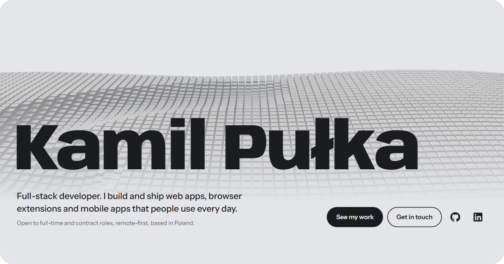

<div align="center">

[](https://kpulka.com)

<a href="https://github.com/kpulka247/portfolio-kpulka/actions/workflows/release.yml" title="Release and deploy"></a>
<a href="https://github.com/kpulka247/portfolio-kpulka/releases" title="GitHub Release"></a>

</div>

## Overview

The source of [kpulka.com](https://kpulka.com), the portfolio of Kamil Pułka, a full-stack developer from Poland.

- **Hero.** A three.js pin board that reacts to the pointer, with an optional toy car to drive. It loads after the page and falls back to a still image on slow devices and with reduced motion.
- **Projects.** Each project is one data file, which gives it a card on the home page and a prerendered page at `/projects/<slug>`.
- **Store numbers.** Users, ratings, releases and downloads are fetched from the Chrome Web Store, Firefox Add-ons, Google Play and GitHub at build time.
- **Search and sharing.** Canonical URLs, a sitemap, Open Graph images and Person structured data.
- **Privacy.** No cookies. Visits are counted with Cloudflare Web Analytics, which stores nothing on the device.

## Tech stack

- React 19, TypeScript and React Router 7, prerendering every page
- Tailwind CSS 4, with self-hosted Anybody and Instrument Sans
- three.js
- Vite 7, Vitest and Playwright
- GitHub Actions, GitHub Pages and semantic-release

## Development & Build

You need [Node.js](https://nodejs.org) 20 or newer, [pnpm](https://pnpm.io/) 10 or newer, and [Git](https://git-scm.com/).

```bash
pnpm install       # install dependencies
pnpm dev           # dev server on http://localhost:5173 and on your network
pnpm build         # fetch store numbers, typecheck and prerender into dist/client
pnpm test          # unit tests
pnpm test:e2e      # Playwright tests against dist/client
pnpm lint          # ESLint
pnpm stats         # fetch store numbers without building
```

The end-to-end tests need a build and Playwright's Chromium once: `pnpm exec playwright install chromium`.

Two scripts render images from the site itself and run by hand. `node scripts/make-images.mjs` writes the link previews in `public/og/` and the README banner. `node scripts/capture-hero.mjs` writes the still image of the board.

## Adding a project

1. Create `src/content/projects/<slug>.ts`. The file name is the slug and the page address. `src/content/schema.ts` describes each field.
2. Put its images in `src/assets/projects/<slug>/`. To crop them from the project's own repository, add jobs to `scripts/make-covers.mjs`.
3. Add it to the `projects` list in `src/content/projects/index.ts`. `order: 1` puts it first.
4. Add its store IDs and GitHub repository to `src/content/sources.json`, then run `pnpm stats`.
5. Run `node scripts/make-images.mjs`, then `pnpm build && pnpm test && pnpm test:e2e`.

## Deployment

Every push to `main` builds the site and deploys it to GitHub Pages. [semantic-release](https://github.com/semantic-release/semantic-release) picks the version from the [Conventional Commits](https://www.conventionalcommits.org/) and writes the changelog entry and the GitHub Release. The workflow also runs every Monday to refresh the store numbers.

Analytics are on when the repository variable `CF_BEACON_TOKEN` holds the Cloudflare Web Analytics token.

## License

Copyright © Kamil Pułka. All rights reserved.

## Changelog

Changes for each release are in [CHANGELOG.md](./CHANGELOG.md).
